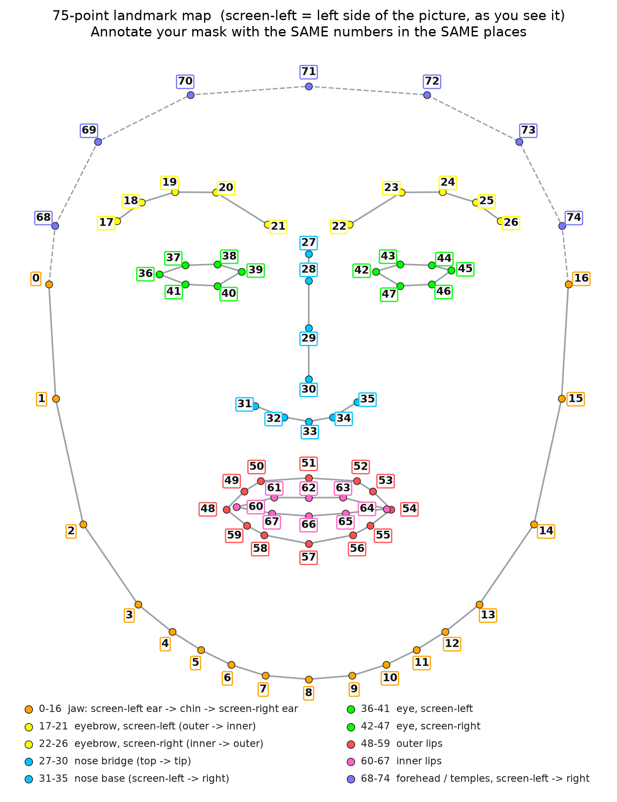

[Uploading Screencast from 06 نوف, 2026 CAT 12:36:54 ص.webm…]()
# Creating-face-filters-using-Mediapipe-and-OpenCv
Have you ever wondered how snapchat filters works ? In this repo , I will show you step by step how to make your own mask and impelmented in real time via your webcam. #Mediapipe #OpenCV #Snapchat #Face_Filters

# AR Mask Filter

Real-time, Snapchat-style face-mask filter in Python, built with **MediaPipe Face Mesh + OpenCV** in a single script. A transparent PNG mask is warped onto your face, follows your expressions, and can be swapped live.

Based on the LearnOpenCV tutorial [Create Snapchat/Instagram Filters Using Mediapipe](https://learnopencv.com/create-snapchat-instagram-filters-using-mediapipe/).

## How it works

1. MediaPipe finds 468 face landmarks. The script keeps **75** of them, numbered **0–74**.
2. You mark the **same 75 points** on your mask image (with [makesense.ai](https://www.makesense.ai)) and export a CSV.
3. Every frame, the mask and your face are split into matching triangles (Delaunay), each triangle is warped onto the face, and the result is alpha-blended. Optical flow smooths landmark jitter.

## Requirements

| | |
|---|---|
| **Python** | 3.9 – 3.12 (64-bit) |
| **OS** | Linux x86-64 with glibc ≥ 2.28 and Python 3.9–3.12 (e.g. Ubuntu 22.04 / 24.04). Developed on Ubuntu with Python 3.12. No ARM builds (Raspberry Pi unsupported). Windows/macOS: see [Troubleshooting](#troubleshooting). |
| **Hardware** | A webcam (not needed for `--image` / `--video` modes) |
| **Packages** | `mediapipe==0.10.21`, `numpy<2` (see `requirements.txt`) |

> [!IMPORTANT]
> The MediaPipe version matters. This project uses the legacy `mp.solutions` API, which was **removed in MediaPipe 0.10.30+**. `0.10.21` is the last release that has it, so it is pinned.
> OpenCV arrives automatically with MediaPipe (`opencv-contrib-python`). Do **not** also install `opencv-python`; the two conflict.

## Install

```bash
git clone https://github.com/<your-username>/<repo-name>.git
cd <repo-name>

python3 -m venv .venv
source .venv/bin/activate
pip install -r requirements.txt

# sanity check, must print: 0.10.21 True
python -c "import mediapipe as mp; print(mp.__version__, hasattr(mp, 'solutions'))"
```

## Quick start

```bash
python ar_mask_filter.py run
```

This loads the included demo mask (`masks/demo_mask.png`) and opens your webcam.

| Key | Action |
|---|---|
| `F` | next filter |
| `L` | show / hide the 75 landmarks |
| `S` | save a screenshot |
| `Q` / `Esc` | quit |

No webcam? Use a photo or a video file:

```bash
python ar_mask_filter.py run --image me.jpg --out result.png
python ar_mask_filter.py run --video clip.mp4 --out result.mp4 --no-gui
```

## Use your own mask

**1. Prepare the image.** A PNG with a transparent background, front-facing, upright, not mirrored. Save it as `masks/mymask.png`.

**2. Annotate it.** Run `python ar_mask_filter.py labels` (or use the included `labels.txt`). Then in [makesense.ai](https://www.makesense.ai):
drop in your mask → *Object Detection* → load `labels.txt` as the label list → pick the **Point** tool → click each label on the matching spot of the mask → *Actions → Export Annotations → CSV*.
Save the file as `masks/mymask.csv` (same name as the PNG).

Use [`landmark_map.png`](landmark_map.png) as your guide, or run `python ar_mask_filter.py view` to see the numbered points live on your own face.

**3. Check it.**

```bash
python ar_mask_filter.py check masks/mymask.png
```

This draws your points and the triangulation on the mask (also saved next to it as `masks/mymask_check.png`). Fix anything that looks off.

**4. Run it.** `python ar_mask_filter.py run`. Masks in `masks/` are picked up automatically.

### Mask rules

- **The label number is what matters.** Label `N` on the mask must sit on the same facial spot as label `N` on the map. The click order doesn't matter.
- **Full-face mask:** all 75 labels (0–74).
- **Accessory** (ears, hat, nose…): exactly **2** points. Their labels are the face landmarks they attach to (e.g. `68` and `74` are the temples), and the image is moved, rotated and scaled to match.
- The CSV's first three columns must be `label,x,y` (the makesense export); header lines are ignored.
- Mask images larger than 1024 px are downscaled automatically (annotations are scaled too).
- **Shortcut:** `python ar_mask_filter.py auto masks/mymask.png` writes the CSV for you, but only works if the mask looks like a real human face.

```
.
├── ar_mask_filter.py
├── requirements.txt
├── labels.txt
├── landmark_map.png
└── masks/
    ├── demo_mask.png
    └── demo_mask.csv
```

## Commands

| Command | What it does |
|---|---|
| `labels` | Writes `labels.txt` (0–74) to import into makesense.ai |
| `view [--image photo.jpg]` | Shows the 75 numbered landmarks on the webcam or a photo |
| `auto mask.png` | Auto-annotates a realistic-face mask and writes `mask.csv` |
| `check mask.png` | Draws annotations + triangles on a mask to verify it |
| `run [--mask NAME] [--image F] [--video F] [--out F] [--no-gui]` | Runs the filter |

## Settings

Everything adjustable is an `ALL_CAPS` constant at the top of `ar_mask_filter.py`. The most useful ones:

| Constant | Default | Meaning |
|---|---|---|
| `CAMERA_INDEX` | `0` | Which camera (`/dev/video0` → 0) |
| `CAMERA_BACKEND` | `cv2.CAP_V4L2` | Linux webcam backend |
| `REQUEST_FRAME_WIDTH` / `HEIGHT` | `1280` / `720` | Capture size; lower it for more FPS |
| `MIRROR_VIEW` | `True` | Mirror the image like a selfie camera |
| `MASK_OPACITY` | `1.0` | `0.0` invisible … `1.0` opaque |
| `STABILIZATION_SIGMA` | `50.0` | Higher = smoother but slightly laggier |
| `SHOW_LANDMARKS_AT_START` | `False` | Start with the landmarks visible |

## Landmark map



| Labels | Feature |
|---|---|
| 0–16 | Jaw: left ear → chin → right ear |
| 17–21 / 22–26 | Eyebrows (left / right) |
| 27–30 / 31–35 | Nose bridge / nose base |
| 36–41 / 42–47 | Eyes (left / right) |
| 48–59 / 60–67 | Outer lips / inner lips |
| 68–74 | Forehead and temples |

"Left" and "right" are as seen on screen.

## Troubleshooting

| Problem | Fix |
|---|---|
| `module 'mediapipe' has no attribute 'solutions'` | Wrong MediaPipe version: `pip install "mediapipe==0.10.21" "numpy<2"` |
| Webcam won't open | `ls -l /dev/video*`; make sure you're in the `video` group (`sudo usermod -aG video $USER`, then log in again); close other apps using the camera; try `CAMERA_INDEX = 1` or `CAMERA_BACKEND = cv2.CAP_ANY` |
| Window won't open (Qt / xcb error) | `sudo apt install libxcb-xinerama0`, or `export QT_QPA_PLATFORM=xcb` |
| Low FPS (~10) | Keep `REQUEST_FOURCC = "MJPG"` and/or lower `REQUEST_FRAME_WIDTH` / `HEIGHT` |
| `ERROR loading ...: has N points` | A full-face mask needs all 75 labels; an accessory needs exactly 2 |
| Mask looks twisted or misplaced | Run `check`. Labels must be the numbers from the map, on the matching spots |
| OpenCV import errors | Keep only one OpenCV package: `pip list \| grep -i opencv` |
| Lines starting with `W0000` / `INFO` | Harmless MediaPipe log messages |
| Windows / macOS | MediaPipe 0.10.21 has wheels for both, but this project is untested there; set `CAMERA_BACKEND = cv2.CAP_ANY` |

## Limitations

- 2D only: the mask is a flat image, so it can't do true 3D objects (glasses with depth), and very strong head turns stretch it.
- One face at a time (`MAX_NUM_FACES = 1`).
- Full-face masks need all 75 annotated points.
- Uses MediaPipe's legacy `mp.solutions` API, hence the pinned version.

## Credits

- Pipeline and landmark selection: [LearnOpenCV tutorial](https://learnopencv.com/create-snapchat-instagram-filters-using-mediapipe/).
- `landmark_map.png` is drawn from the geometry of MediaPipe's canonical face model.
- `masks/demo_mask.png` was generated for this repo.
